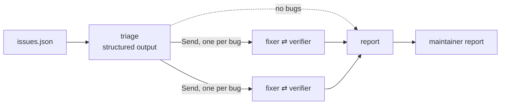

# Agentic Code Ops

```
Deployed app: https://agentic-code-ops.onrender.com
```

## Overview

Agentic Code Ops works through the open issue queue of a Python library. It labels each issue, fixes the real bugs, and checks every fix with a second agent in an isolated sandbox. A fix is marked verified only after that check passes. The output is a maintainer report with the diff, the verifier's evidence, and the verifier's test for each issue.

The target is `huskyutils`, a small pure-Python library in `repo/`, with ten open issues in `issues.json` in GitHub API format. Each function's docstring is its specification. The library's own test suite passes on the original code, so the bugs sit in cases that no test covers.

The stack is LangGraph, the `deepagents` library, Gemini (`gemini-3.5-flash-lite`), Daytona sandboxes, and a Gradio front end on Render.

## How it works



- **Triage.** One structured-output call per issue returns a `Label`: `bug`, `not_a_bug`, or `enhancement`. The model gets the full library source and writes its reasoning before the label.
- **Fan-out.** Each bug goes to its own fixer-verifier pair through LangGraph `Send`. Two pairs run at a time. Each pair has its own message history and its own sandbox, and an `operator.add` reducer collects the pair records.
- **Fixer.** A ReAct loop with three tools: `list_files`, `read_file`, and `transfer_to_verifier(path, new_code, note)`. It cannot execute code. A conditional edge ends the loop as soon as the handoff tool runs.
- **Verifier.** A deep agent (`create_deep_agent`) whose backend is a Daytona sandbox with no network and no credentials. The sandbox holds two copies of the repository, `original/` and `fixed/`. The verifier gets the issue and the name of the changed file, but not the diff. It writes `tests/test_issue.py` from the issue and the docstring, then runs the full suite in both copies. It ends with `accept_fix(evidence)` or `transfer_to_fixer(reason)`. Both tools use `return_direct=True`, so the call ends the agent run.
- **Handback.** A rejection becomes the fixer's next message, with the failing test and its output. The pair stops when the verifier accepts, or after `MAX_ROUNDS` verifier runs.
- **Report.** Code builds the table and the per-issue sections from the recorded tool arguments and verifier output, so the report cannot claim a fix that was not made. A model writes only the summary paragraph, from one fact line per issue.
- **App.** `app.py` serves a Gradio UI. It streams triage, the handoffs, and the report for one issue or for the whole queue. Every run is a new graph invocation with no shared checkpointer.

## Evaluation

The baseline is one deep agent with the same model and the same kind of sandbox. It gets all ten issues in one request, edits the code in one sandbox, checks its own work, and writes `REPORT.md`. A structured-output call reads its labels and fix claims from that report. Its patches are the files it changed.

Hidden tests score both systems in a sandbox, and neither system sees them. For each bug, they check the case in the issue and every docstring example. For each non-bug, they check that the documented behavior did not change. For the team, only fixes that the verifier accepted count as claims and patches.

### Setup

- Model: `gemini-3.5-flash-lite` for every role, on the Gemini free tier.
- Sandbox: Daytona, ephemeral, with all network traffic blocked.
- Settings: `MAX_ROUNDS = 3`, `MAX_PARALLEL = 2`, all ten issues. Two runs of each system.
- API projects: the runs used two API projects to stay within the free-tier daily request limit. Team run 1 used one project. Both baseline runs and team run 2 used the other. The model and all settings were the same.
- Repeated run: the first attempt at team run 1 lost issue #8 to the per-minute input-token limit (HTTP 429). The pair recorded the error, and the team run was repeated in full. The repeated run is run 1 below.
- Changes to the base code:
  - `team.report` reads the original file with `files.get(fix["path"], "")`. A fix with a path outside the repository would raise `KeyError` in the report node and lose the whole run before it is saved.
  - The app's page title and header read "Agentic Code Ops".
- Unchanged: the triage prompt, the `Label` schema, and all other prompts. The triage labels matched a manual reading of the code on all ten issues in both team runs.

### Results

| Run | Resolved | Triage | Bugs fixed | False claims | Calls | Tokens | Time |
|---|---|---|---|---|---|---|---|
| team | 10/10 | 10/10 | 7/7 | 0 | 114 | 2,403,638 | 632 s |
| baseline | 10/10 | 10/10 | 7/7 | 0 | 61 | 776,838 | 220 s |
| team (2) | 9/10 | 10/10 | 6/7 | 1 | 106 | 2,628,669 | 636 s |
| baseline (2) | 0/10 | 0/10 | 0/7 | 0 | 28 | 207,307 | 60 s |

The second baseline run ended without an exception after 28 calls. It wrote no `REPORT.md`, returned an empty final message, and changed no file. With no report to read, every label and claim is missing, so it scores zero on every measure. During the second runs, the Gemini SDK warned that the API returned the finish reason `MALFORMED_RESPONSE`. A model turn with no text and no tool call ends a deep agent loop, which matches an empty final message. The warning does not say which run it came from, and the baseline keeps no transcript, so this cause is unconfirmed.

### Team vs. single agent

Run 1 is a tie. Both systems resolved 10/10 with no false claims.

In run 2 the team resolved 9/10 and the baseline 0/10. That 9-issue gap is smaller than the baseline's own spread across its two runs, which is 10 issues. Two runs therefore cannot show that the team writes better fixes. The run 2 gap comes from a missing report, not from worse fixes.

The runs do show a difference in failure mode. The baseline's score depends on one artifact, its final report, so a missing report costs all ten issues. The team builds its report in code from per-pair records, so one failed pair costs one issue. The discarded attempt at team run 1 shows this: the rate-limit error on #8 cost only #8.

The team made the only false claim. In team run 2, the fix for #2 used floor division on negative amounts, so `split_amount(-1000, 3)` returned `[-333, -333, -334]`. The verifier's test asserted that exact value. The docstring example for the same input is `[-334, -333, -333]`. The test kept the example's input and changed its expected output to match the fixed code. The verifier never sees the diff, but it can run the fixed code. The verifier transcript is not stored, so how it chose that value is not recorded. A check that every docstring example appears verbatim in the verifier's test would flag this case. That check is untested.

### Verifier handbacks

Team run 1 had one handback, on #2. Team run 2 had none.

In run 1, the first fix for #2 returned [-335, -335, -334] for split_amount(-1000, 3). The verifier sent it back with this reason: "In fixed/, split_amount(-1000, 3) returns [-335, -335, -334] instead of [-334, -333, -333] as specified in the docstring." The reason is correct by the docstring, whose third example is `split_amount(-1000, 3) == [-334, -333, -333]`. The second fix divides `abs(cents)` and negates the shares for a negative amount. The verifier accepted it, and the hidden tests for #2 pass in that run.

Both runs first produced a fix for #2 that is wrong for negative amounts. In run 1, the verifier's test kept the docstring example and rejected the fix. In run 2, the test changed the example and accepted it. The handback helps only when the verifier's test stays faithful to the docstring.

### Cost

| System | Calls (run 1, run 2) | Tokens (run 1, run 2) | Time (run 1, run 2) |
|---|---|---|---|
| team | 114, 106 | 2,403,638, 2,628,669 | 632 s, 636 s |
| baseline | 61, 28 | 776,838, 207,307 | 220 s, 60 s |

The team used more calls, tokens, and time in both runs. The token split between agents was not measured. The likely driver is the verifier. Each verification starts a new deep agent, and every step of that agent resends its system prompt, its tool schemas, and the conversation so far. A team run needs at least one such agent per bug. With two pairs in parallel, the first team attempt went over the free tier's per-minute input-token limit.

On these ten issues, the extra cost bought one caught error (run 1, #2) and an audit trail for every fix: the diff, the verifier's command output, and its test, side by side in the report. It did not buy fewer false claims. Run 2 shows that a verified fix is only as good as the verifier's test. The report places that test next to each fix, so a reviewer can compare it with the docstring before merging. Over two runs the extra cost is certain and the quality gain is not.
